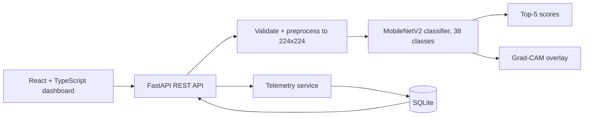
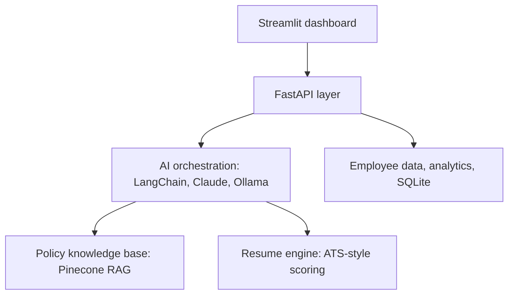
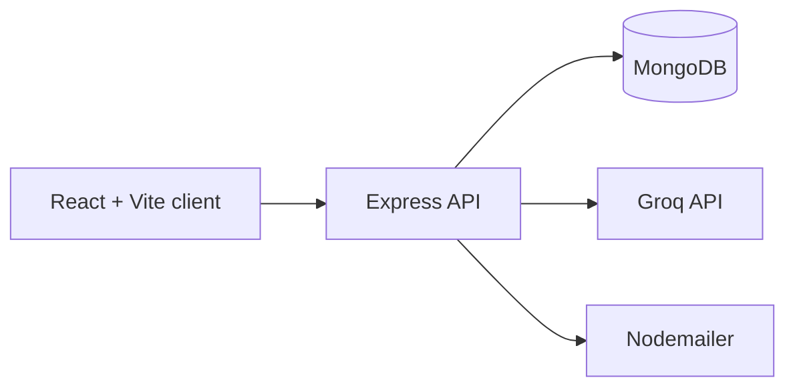
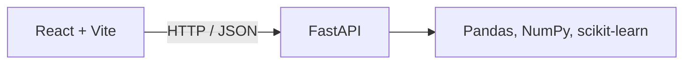
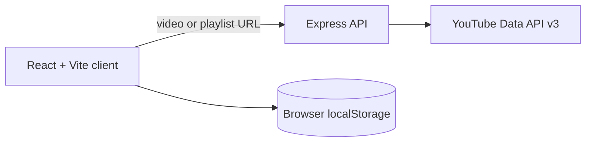

<!--
  Assets required in this repo (akhil3145/akhil3145):
    assets/divider.svg
    assets/terminal.svg
  Everything else loads from public services or from your project repositories.
-->

<h1 align="center">Hi, I'm Akhil Pandey 👋</h1>

  <b>AI/ML Developer · Building Intelligent Systems · Python &amp; Full-Stack Engineering</b>

  

  I'm a fourth-year B.Tech student in Data Science &amp; AI at SRMU, Lucknow, building AI-powered software end to end:
  from model training and evaluation to FastAPI backends and React interfaces. My strongest work so far pairs deep
  learning with explainability and monitoring, because a model is only useful if you can understand how it behaves.

  
  
  
  
  
  
  

  
  
  

## About

- **Education:** B.Tech in Computer Science (Data Science & AI), Shri Ramswaroop Memorial University, Lucknow. Fourth year, graduating 2027.
- **Direction:** Aspiring AI/ML engineer building end-to-end AI applications, from model to API to interface.
- **Exploring now:** Advanced ML, LLM applications, RAG and backend engineering.
- **Practice:** Data structures and algorithms in Python.
- **Open to:** AI engineering and software development opportunities.

  

## Projects

Each project shows the essentials first. Expand **Architecture & details** for the engineering behind it.

### 1. Vistara AI

**Plant disease screening with MobileNetV2, Grad-CAM explainability and monitoring.** Team project.

Python · TensorFlow/Keras · MobileNetV2 · FastAPI · Pydantic v2 · React 19 · TypeScript · Vite · Tailwind CSS · SQLite

**[Repository](https://github.com/akhil3145/vistara-ai)** · No hosted demo (runs locally)

<b>Architecture &amp; details</b>

 

Classifies a leaf image into one of **38 PlantVillage classes across 14 crop species**. A scan returns ranked scores, a Grad-CAM overlay, latency and telemetry, with a clear distinction between a live backend response and a demo preview.

**Features**
- Single-image upload with type and size validation, ranked top-5 predictions and a server-generated Grad-CAM overlay
- Batch analysis of up to 24 images with per-file status, accepted/rejected counts and filter-aware CSV export
- Monitoring dashboard: request volume, class distribution, mean score, p50/p95 latency and recent events
- Model evaluation report read from a stored artifact, plus a searchable library of the 38 classes
- Typed API boundary: Pydantic v2 contracts with explicit error codes

**Evaluation (PlantVillage held-out split, controlled benchmark)**
- 98.04% test accuracy on 8,146 test images; macro F1 97.47%
- Weakest class in the stored report: corn gray leaf spot (F1 0.8514)
- These figures are not field-condition accuracy

**Engineering considerations documented in the repo**
- A Grad-CAM failure never blocks a prediction
- If the model can't load, the API returns `model_unavailable` instead of fabricated scores
- Drift status is reported as unavailable until a verified baseline distribution exists
- Class order in `classes.json` must match the trained model, or labels are silently wrong

**Limitations:** closed-set 38-class model, scores are not calibrated probabilities, model artifacts are not committed, no authentication or production deployment configuration. Educational decision-support software, not a diagnostic tool.

**Screenshots:** [Overview](https://github.com/akhil3145/vistara-ai/blob/main/docs/screenshots/overview.png) · [Scanner](https://github.com/akhil3145/vistara-ai/blob/main/docs/screenshots/scanner.png) · [Grad-CAM](https://github.com/akhil3145/vistara-ai/blob/main/docs/screenshots/gradcam.png) · [Batch](https://github.com/akhil3145/vistara-ai/blob/main/docs/screenshots/batch.png) · [Monitoring](https://github.com/akhil3145/vistara-ai/blob/main/docs/screenshots/monitoring.png) · [Model report](https://github.com/akhil3145/vistara-ai/blob/main/docs/screenshots/model-report.png)

### 2. Orchestrix

**AI-native HR platform: policy Q&A with RAG, resume screening and workforce analytics.**

Python · FastAPI · Streamlit · LangChain · Pinecone · Claude / Ollama · SQLite · Pandas · Plotly · pypdf

**[Repository](https://github.com/akhil3145/Orchestrix)** · No hosted demo

<b>Architecture &amp; details</b>

 

Combines deterministic HR workflows with LLM-powered assistance in one dashboard. Capabilities below are as described in the repository README.

**Features**
- AI HR assistant with multi-route query handling, designed around Claude with a local fallback
- Resume intelligence: PDF parsing, ATS-style scoring, skill extraction, candidate ranking and downloadable reports
- HR policy retrieval and semantic search using RAG over a Pinecone index
- Workforce analytics: headcount, department insights, leave utilization and AI-generated summaries
- Employee operations: leave balances, payroll previews and HR request workflows

**Roadmap listed in the repo:** PostgreSQL migration, more advanced RAG pipelines, candidate-job matching, multi-tenant architecture.

**Status:** documented architecture and roadmap; no hosted demo.

### 3. PitchPilot 

**AI outreach generator for cold emails, LinkedIn DMs and follow-ups.**

> Adapted from the open-source starter [ShivaMani02/AI-COLD-MAIL-GENERATOR-MONOREPO](https://github.com/ShivaMani02/AI-COLD-MAIL-GENERATOR-MONOREPO). I'm customizing it to learn authentication, LLM integration and Docker, so it is a learning project, not entirely original work.

React · Vite · Tailwind CSS · Node.js · Express · MongoDB · Groq API · JWT · Nodemailer · Docker

**[Repository](https://github.com/akhil3145/PitchPilot)** · No hosted demo

<b>Architecture &amp; details</b>

 

**In the codebase**
- Generation of outreach messages through the Groq API
- Signup, login and OTP verification flows with JWT and bcrypt
- MongoDB models for users and email history
- Dockerfiles and a Docker Compose configuration

**Roadmap (from the repo):** verify MongoDB connectivity, test auth and OTP end to end, test Groq generation and email delivery, add automated tests and a CI workflow, then verify deployment.

**Status:** under active development; some features and deployment settings still need end-to-end testing.

### 4. ML Studio

**Browser-based ML workflow: upload a CSV, train a model, review metrics, predict.**

Python · FastAPI · scikit-learn · Pandas · NumPy · React · Vite · Axios

**[Repository](https://github.com/akhil3145/ml_studio_codeveda)** · [Live demo](https://ml-studio-frontend-xe8i.onrender.com) (may take a moment to wake up)

<b>Architecture &amp; details</b>

 

**Features**
- CSV upload with dataset inspection (rows, columns, feature and target columns)
- Training routes for KNN, logistic regression, decision tree, random forest and linear regression
- Accuracy and training metrics shown in the dashboard, with loading and status feedback
- Prediction interface (a KNN prediction route is documented)

**Implementation notes**
- One route module and one model module per algorithm, plus a shared dataset service, keeps each workflow modular
- A preprocessing route and module are included in the backend

**Roadmap listed in the repo:** model persistence, more evaluation metrics, confusion matrices, hyperparameter tuning, prediction for all trained model types.

### 5. LearnFlow

**Turns a YouTube video or playlist into a structured, trackable bootcamp-style course.**

JavaScript · React · Vite · Node.js · Express · YouTube Data API v3

**[Repository](https://github.com/akhil3145/LMS_2.o)** · [Live demo](https://lms-2-o.vercel.app)

<b>Architecture &amp; details</b>

 

**Features**
- Converts playlists into multi-module courses and splits long videos into sections
- A lesson can only be marked complete after 90% watch progress
- Course progress as a completion percentage, with a dashboard of bootcamp cards
- Interactive course player with sidebar navigation

**Implementation notes**
- The backend generates the bootcamp structure; the frontend saves the user, bootcamps and completed lessons in `localStorage`, so progress resumes in the same browser
- No authentication or database yet (both listed on the roadmap, along with AI summaries and chapter titles)

### 6. Strenzz

**A no-account, no-build strength tracker I made for my own training.**

Vanilla JavaScript · HTML · CSS · Chart.js · localStorage

**[Repository](https://github.com/akhil3145/strenzz)**

<b>Architecture &amp; details</b>

 

**Features**
- Lift logging: exercise, weight, sets, reps and notes
- Progress graphs by week, month or all time
- Strength rank: percentile comparison against general lifting standards for your bodyweight
- Calculators: one-rep max estimator, BMI and body fat percentage (Navy method)

**Implementation notes**
- Single `index.html`, no framework and no build step; Chart.js is loaded from a CDN
- All data stays in the browser's `localStorage`; nothing is sent anywhere
- Planned: CSV export, bodyweight tracking over time, custom exercise names, installable PWA

### More on GitHub

- **[Wbot](https://github.com/akhil3145/Wbot):** my first LLM application, a Python chatbot built on Groq's Llama 3 API.
- **[Titanic classification](https://github.com/akhil3145/titanic-classification-algorithms):** five scikit-learn classifiers compared on the Titanic dataset.

## Tech Stack

<table>
  <tr>
    <td><b>Languages</b></td>
    <td></td>
  </tr>
  <tr>
    <td><b>AI &amp; ML</b></td>
    <td></td>
  </tr>
  <tr>
    <td><b>Backend</b></td>
    <td></td>
  </tr>
  <tr>
    <td><b>Frontend</b></td>
    <td></td>
  </tr>
  <tr>
    <td><b>Databases</b></td>
    <td></td>
  </tr>
  <tr>
    <td><b>Tools</b></td>
    <td></td>
  </tr>
  <tr>
    <td><b>Learning</b></td>
    <td></td>
  </tr>
</table>

<b>Where I've used each tool</b>

 

- **TensorFlow / Keras, MobileNetV2, Grad-CAM:** Vistara AI
- **scikit-learn, Pandas, NumPy:** ML Studio, Titanic classification (Matplotlib and Jupyter / Colab as well)
- **FastAPI, Pydantic:** Vistara AI, Orchestrix, ML Studio
- **LangChain, Pinecone (RAG), Streamlit, Plotly:** Orchestrix
- **Groq API (Llama 3):** Wbot, PitchPilot
- **React, Vite:** Vistara AI, ML Studio, LearnFlow, PitchPilot (TypeScript and Tailwind CSS in Vistara AI)
- **Node.js, Express:** LearnFlow, PitchPilot
- **SQLite:** Vistara AI, Orchestrix
- **MongoDB, Docker (still learning):** PitchPilot
- **Vanilla JavaScript, Chart.js:** Strenzz

## Experience

- **Machine Learning Engineering Intern**, Codveda Technologies. Project work: [ML Studio](https://github.com/akhil3145/ml_studio_codeveda).
- **Intern**, InternPe.

## GitHub Analytics

  <a href="https://github.com/akhil3145">
    <picture>
      <source media="(prefers-color-scheme: dark)" srcset="https://github-readme-stats.vercel.app/api?username=akhil3145&show_icons=true&hide_border=true&hide_rank=true&bg_color=0D1117&title_color=22D3EE&icon_color=A78BFA&text_color=E5E7EB" />
      <source media="(prefers-color-scheme: light)" srcset="https://github-readme-stats.vercel.app/api?username=akhil3145&show_icons=true&hide_border=true&hide_rank=true&bg_color=FFFFFF&title_color=0891B2&icon_color=7C3AED&text_color=1F2937" />
      
    </picture>
    <picture>
      <source media="(prefers-color-scheme: dark)" srcset="https://github-readme-stats.vercel.app/api/top-langs/?username=akhil3145&layout=compact&langs_count=6&hide_border=true&bg_color=0D1117&title_color=22D3EE&text_color=E5E7EB" />
      <source media="(prefers-color-scheme: light)" srcset="https://github-readme-stats.vercel.app/api/top-langs/?username=akhil3145&layout=compact&langs_count=6&hide_border=true&bg_color=FFFFFF&title_color=0891B2&text_color=1F2937" />
      
    </picture>
  </a>

  <picture>
    <source media="(prefers-color-scheme: dark)" srcset="https://streak-stats.demolab.com?user=akhil3145&hide_border=true&background=0D1117&ring=22D3EE&fire=A78BFA&currStreakNum=E5E7EB&sideNums=E5E7EB&currStreakLabel=22D3EE&sideLabels=9CA3AF&dates=9CA3AF" />
    <source media="(prefers-color-scheme: light)" srcset="https://streak-stats.demolab.com?user=akhil3145&hide_border=true&background=FFFFFF&ring=0891B2&fire=7C3AED&currStreakNum=1F2937&sideNums=1F2937&currStreakLabel=0891B2&sideLabels=6B7280&dates=6B7280" />
    
  </picture>

  <picture>
    <source media="(prefers-color-scheme: dark)" srcset="https://github-readme-activity-graph.vercel.app/graph?username=akhil3145&bg_color=0D1117&color=22D3EE&line=A78BFA&point=E5E7EB&area=true&hide_border=true" />
    <source media="(prefers-color-scheme: light)" srcset="https://github-readme-activity-graph.vercel.app/graph?username=akhil3145&bg_color=FFFFFF&color=0891B2&line=7C3AED&point=1F2937&area=true&hide_border=true" />
    
  </picture>

Live data from public GitHub activity. Language percentages reflect code volume, not proficiency.

## DSA

I practice data structures and algorithms in Python on NeetCode, with solutions synced to GitHub and organized into topic folders: Data Structures &amp; Algorithms, Python Coding Interviews and Python For Beginners. The goal is steady practice and sound problem-solving fundamentals rather than a leaderboard number.

**[Browse my solutions →](https://github.com/akhil3145/Neetcode_DSA)**

## Currently Exploring

  
  
  
  
  
  
  
  

## Beyond Coding

When I'm not building AI systems, I'm usually exploring the universe, prehistoric life, or pushing my limits in the gym. Astronomy and space exploration, paleontology and dinosaurs, and strength training (which led to Strenzz) all feed the same habit: stay curious, be patient, make steady progress.

## Contact

  
  
  

  Early in the journey, building in public. 
  

